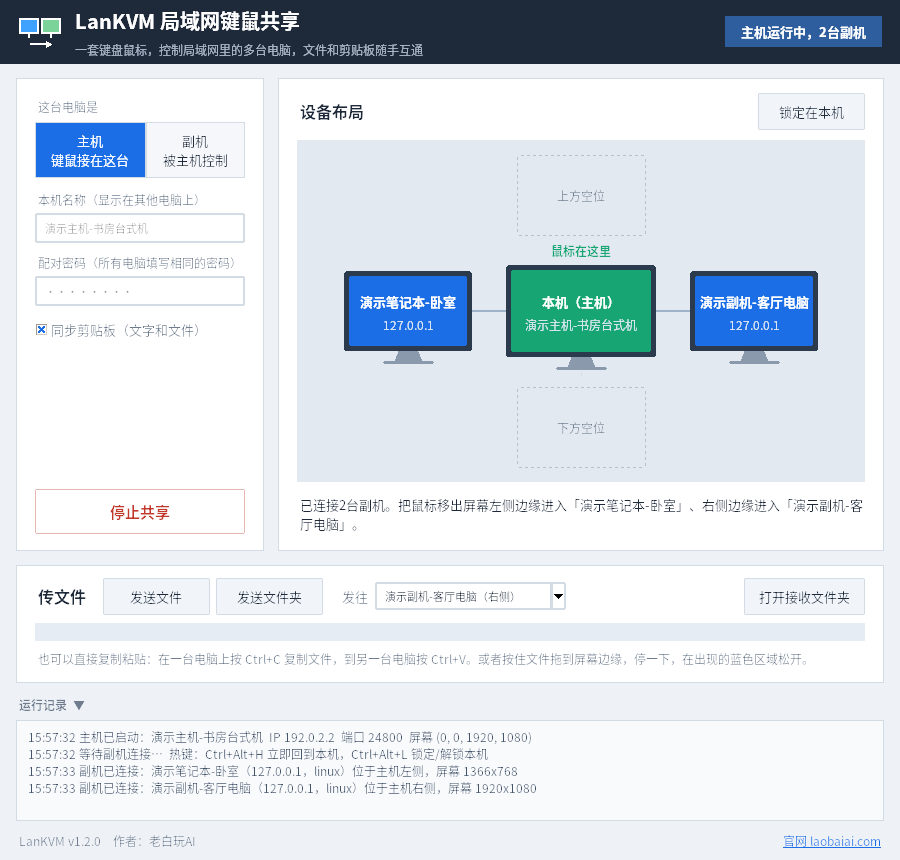

# LanKVM 局域网键鼠共享

作者：**老白玩AI** · 官网：<https://laobaiai.com/>



> 截图为演示数据。

纯软件的局域网键鼠共享工具，不需要对拷线或扩展坞。两台（最多 5 台）电脑连在同一个局域网（同一路由器、Wi-Fi 或网线都可以）就能用。

| 功能 | 说明 |
|---|---|
| 一套键鼠控制多台电脑 | 主机的键盘鼠标同时控制副机 |
| 穿屏 | 鼠标移出主机屏幕边缘，自动进入副机；反方向移回即返回本机 |
| 剪贴板同步 | 在一台电脑复制文本，在另一台直接粘贴（双向） |
| 文件复制粘贴 | 在一台电脑 Ctrl+C 复制文件/文件夹，到另一台电脑 Ctrl+V 直接粘贴（粘贴时才开始传输） |
| 文件拖放 | 按住文件拖到屏幕边缘停一下，在出现的蓝色区域松开，即发送到另一台电脑 |
| 文件/文件夹互传 | 也可以用“发送文件”按钮，保留目录结构，存到 `下载/LanKVM` |
| 跨系统 | Windows ⇄ macOS ⇄ Linux 任意组合；支持 Ctrl↔Cmd 映射 |
| 自动发现 | 副机自动找到局域网里的主机，不用填 IP |
| 配对密码 | HMAC 挑战认证，不知道密码的电脑无法连接 |
| 多副机 | 主机上、下、左、右各一台，最多 4 台副机；界面上的“设备布局”实时显示各台电脑和鼠标所在位置 |
| 屏保/熄屏唤醒 | 鼠标移入副机时自动点亮屏幕、退出屏保；可选“防止这台电脑自动睡眠” |

## 安装（Windows，推荐）

双击 **`LanKVM_Setup.exe`**（约 12 MB，可在本仓库的 Releases 页面下载），按提示点“是”即可：

1. 自动检测本机 Python（3.8 及以上，并带 tkinter）。**已经装好的直接使用，跳过安装**，只离线补装依赖。
2. 没有装的话，自动安装内置的 **Python 3.12.10 免安装版**。它直接从 Python 官方安装程序中提取，文件带官方签名；装在程序目录 `runtime\` 下，不用联网，也不修改系统 PATH 或注册表。
3. 程序会装到 `%LOCALAPPDATA%\LanKVM`，同时创建桌面和开始菜单快捷方式，并登记到“设置 → 应用”中。
4. 添加防火墙放行规则（可能弹出一次管理员确认；选“否”也能用）。
5. 安装完成后自动启动程序。

安装包没有数字签名，第一次运行时 Windows 可能提示“Windows 已保护你的电脑”。点 **更多信息 → 仍要运行** 即可。

卸载：开始菜单 →“卸载 LanKVM”，或者在“设置 → 应用”里卸载。内置的 Python 会一起删除；系统里原有的 Python 和已经接收的文件会保留。

重新打包：先用 `installer/make_runtime.py` 从官方安装程序生成运行环境，再执行 `installer/build_setup.sh`。

## 安装（macOS）

解压 **`LanKVM-Mac安装包.zip`**（Releases 页面下载），右键点击“安装LanKVM.command”→“打开”，按提示操作：

1. 已有合适的 Python（3.8 及以上，带 Tk 8.6）时直接使用；没有则使用内置的 Python 3.12 免安装版（无需联网，只放在 LanKVM.app 内部）。
2. 生成“应用程序/LanKVM.app”，以后从启动台打开。
3. 按提示在“系统设置 → 隐私与安全性”中给 LanKVM 打开“辅助功能”和“输入监控”。

卸载：双击“卸载LanKVM.command”。详见安装包内的“使用前必读.txt”。重新打包：`installer/mac/build_mac.sh`。

## 安装（Linux / 手动）

每台电脑都需要 Python 3.8 或更高版本：

```bash
pip install -r requirements.txt
```

Windows 用户也可以双击 `打包exe.bat` 生成 `LanKVM.exe`，之后拷到其他 Windows 电脑上直接运行，不用再装 Python。

## 使用

1. **主机**（接着键盘鼠标的那台）：运行 `python lankvm.py`（Windows 上双击 `启动.bat`），选择“主机”，设置配对密码，然后点“启动”。
2. **副机**：同样运行程序，选择“副机”，填写相同的密码，再选择这台电脑放在主机的哪一侧（例如右侧）。主机 IP 一般留空即可自动发现，然后点“启动”。
3. 把鼠标移出主机屏幕右边缘，光标就会出现在副机上。

命令行方式：
```bash
python lankvm.py server -p 密码
python lankvm.py client -p 密码 -s right            # 自动发现主机
python lankvm.py client -p 密码 -s left -H 192.168.1.10
python lankvm.py send -H 192.168.1.20 -p 密码 文件.zip 文件夹/
```

### 在电脑之间传文件

**复制粘贴（推荐）**：在任意一台电脑的资源管理器里选中文件或文件夹，按 Ctrl+C；把鼠标移到另一台电脑，在目标文件夹（或微信、QQ 等聊天窗口）里按 Ctrl+V。
- 传输在你按下 Ctrl+V 时才开始，文件到达后自动完成粘贴。大文件需要等一会儿，右下角会提示进度。
- 主机 ⇄ 副机、副机 ⇄ 副机都可以；副机之间是直接传输，不经过主机中转。
- 同一份复制内容第二次粘贴时不会重复传输。复制了新的文字或文件后，之前的文件复制自动失效。
- “剪切”（Ctrl+X）也按“复制”处理，原电脑上的文件不会被删除。

**拖放**：按住文件拖到屏幕边缘（通向另一台电脑的那一侧），停留约 0.3 秒，边缘会出现蓝色的“松开鼠标 发送到 ××”区域；在上面松开即可。
- 文件存到对方的 `下载\LanKVM`，自动打开文件夹并选中文件，鼠标也会跟着移过去。
- 拖着东西（文件、窗口、选中的文字）时，鼠标不会穿屏，避免按键“粘住”。
- 投放区目前仅支持 Windows 电脑；Mac、Linux 请用复制粘贴。

### 热键（在主机上按）

- **Ctrl+Alt+H**：立即回到本机（应急用，副机卡住时按这个）
- **Ctrl+Alt+L**：锁定或解锁本机。锁定后鼠标不会穿屏，适合打游戏或全屏操作时使用

## 防火墙与端口

首次运行时，Windows 防火墙会弹窗，请勾选“专用网络”并允许。如果是手动放行，需要开放以下端口：

| 端口 | 协议 | 用途 |
|---|---|---|
| 24800 | TCP | 键鼠控制 |
| 24801 | UDP | 自动发现 |
| 24802 | TCP | 文件传输 |

## 各系统权限

- **Windows 锁屏**：副机进入锁屏/登录界面后，出于系统安全限制，任何普通程序都无法代为输入密码，需要在副机上解锁一次。若不希望屏保后锁屏，可在副机的屏保设置中取消“在恢复时显示登录屏幕”。
- **Windows**：如果副机上有以管理员身份运行的窗口（任务管理器、部分安装程序或游戏），副机端也要以管理员身份运行，否则无法操作这些窗口。
- **macOS**：需要在“系统设置 → 隐私与安全性”中，给终端或 Python 同时开启“辅助功能”和“输入监控”。从 Windows 控制 Mac 时，建议勾选“Ctrl ↔ Cmd 互换”。
- **Linux**：需要 X11 会话（Wayland 下请切换到 Xorg 会话）。剪贴板同步需要安装 `xclip`（命令：`sudo apt install xclip`）。

## 工作原理

- 主机通过全局钩子监听键鼠。光标碰到屏幕边缘时，切换为“拦截模式”：本地的点击和按键被吞掉，鼠标每次移动后被拉回屏幕中心，只取位移量。程序据此维护一个副机上的虚拟坐标，把绝对坐标、按键和滚轮通过 TCP 发给副机，由副机注入。
- 往回移出副机边缘，或按 Ctrl+Alt+H，主机就恢复本地控制。副机这时会自动松开所有还按着的键，避免“粘键”。
- 网络发送放在单独的后台线程里，不会阻塞系统钩子（Windows 会自动卸载响应太慢的钩子）。

## 已知限制

- 键鼠事件只做了密码认证，**没有加密**，请只在可信的局域网（家里或公司内网）使用。
- macOS 多显示器只识别主显示器。Windows 多显示器按整体外框判断边缘，如果显示器排列不规则，边缘可能碰不到。
- 剪贴板同步文本和文件；截图之类的“图片数据”暂不同步（可先保存成文件再复制）。
- 文件复制粘贴在 Windows 之间体验最好。主机是 Mac/Linux 时，在主机上粘贴别处复制的文件，第一次按下会先粘贴为空，文件到达后自动再粘贴一次。Linux 需安装 `xclip`。
- 拖放到边缘时，只能投到对方的“下载\LanKVM”文件夹，不能直接投进对方某个打开着的文件夹（这种情况请用复制粘贴）。
- 进入副机后，主机的光标会停在屏幕中央（只是外观问题，不影响使用）。
- Ctrl+Alt+Del、Win+L 这类系统安全组合键无法被拦截或转发。

## 测试

- `python tests/test_headless_e2e.py`：无界面端到端测试（任意系统）。
- `tests/wine/`：Windows 专项测试（投放区不卡死、真实输入唤醒），需在 Windows 或 Wine 中用 Windows 版 Python 运行。
- `tests/screenshots/`：生成使用说明截图的演示脚本（演示数据）。

## 后续可以扩展的方向

- TLS 加密传输
- 剪贴板同步图片
- 同一方向串联多台副机、可视化拖动排列屏幕位置
- 系统托盘和开机自启
